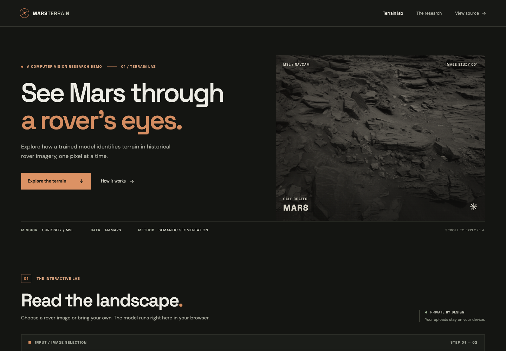
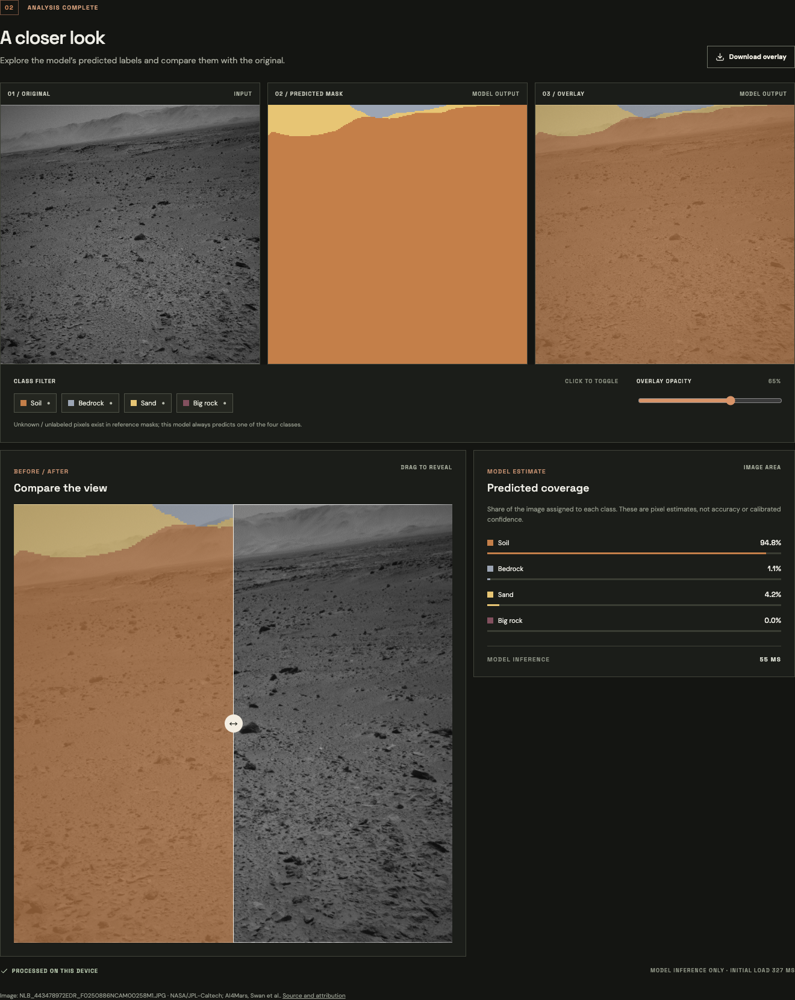
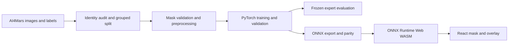

# MarsTerrain — Mars Rover Terrain Segmentation

Rover teams need to understand whether a landscape is made up of loose soil, sand, exposed bedrock or large rocks. MarsTerrain explores that problem with a trained semantic-segmentation model and an interactive image lab. It is a research demonstration, not a rover navigation or safety system.



**Live demo:** deployment pending. · [Source repository](https://github.com/victorhuii/Mars-Rover-Terrain-Segmentation) · [](https://github.com/victorhuii/Mars-Rover-Terrain-Segmentation/actions/workflows/ci.yml)

## Data and labels

The project uses the Curiosity subset of [AI4Mars](https://huggingface.co/datasets/hassanjbara/AI4MARS), pinned to revision `93dbb79de6cd234799750b6129fbfb3b197582fa`. Training and validation masks use four terrain classes: **0 soil, 1 bedrock, 2 sand, 3 big rock**. Value **255** is unlabelled and ignored in loss and metrics; it is not a fifth predicted class. Binary rover and over-30-m range masks also exclude pixels from evaluation.

The mirror contains 18,130 train rows and three expert-label variants of 322 images each. They are alternate annotations, not 966 independent test images. All 322 unique expert images also appear in the train shards; the audit excludes exact matches and conservatively linked scene and perceptual groups. After mask validation, 9,154 images remain in train and 1,557 in validation. The selected model used up to 4,096 of the clean training images. The frozen `test_min3` evaluation contains 322 images, of which 287 have valid pixels after exclusions.

The [official Zenodo record](https://zenodo.org/records/15995036) reports CC BY 4.0; the mirror declares CC0 and the NASA catalogue does not specify a license. Rover images are credited to NASA/JPL-Caltech and AI4Mars. See the [dataset card](docs/dataset_card.md), [third-party notices](docs/third_party_notices.md), and tracked manifests for source hashes, grouping limitations, and attribution. Raw data and intermediate checkpoints are not committed.

## What it does

Choose one of four attributed Curiosity images or upload a JPEG, PNG, or WebP image. The browser loads the actual frozen ONNX model, preprocesses the image locally, and displays the original, predicted mask and overlay. Class filters, opacity, a draggable comparison, estimated pixel coverage and a downloadable PNG help inspect the output. Uploads stay in the browser; no hosted inference API receives them.



*Example imagery: NASA/JPL-Caltech; AI4Mars, Swan et al. Predictions are model outputs, not reference labels.*

## Architecture



The model file is versioned by hash and runs in the visitor's browser. The local Python API uses ONNX Runtime CPU. There is no deployed backend, database or API key.

## Model and measured results

The selected model is a **scratch-initialized MobileNetV3-small encoder with a compact skip decoder**. Training used cross entropy plus soft Dice, class weights derived from the training subset, a fixed seed, and validation-only model selection. The model input is RGB at 256 × 256 with ImageNet mean/std normalization embedded in the graph. Browser uploads are letterboxed; the displayed mask is mapped back to the original aspect ratio.

The model and evaluation protocol were frozen before the single expert `test_min3` run. Classes absent from both truth and prediction are omitted from the mean; ignored pixels do not contribute.

| Metric | Expert test result |
| --- | ---: |
| Mean IoU | **0.6581** |
| Soil / bedrock / sand / big-rock IoU | 0.8463 / 0.8104 / 0.7692 / 0.2066 |
| Mean Dice / pixel accuracy | 0.7560 / 0.8986 |
| Valid labeled pixels | 7,310,367 |
| Big-rock labeled pixels | 4,852 |
| Ignored pixels in evaluated images | 61.13% |
| ONNX model size | 4,385,772 bytes |

The 35 all-ignore images are excluded from pixel metrics. The small big-rock support makes its score fragile; high pixel accuracy alone is misleading in an imbalanced dataset. A U-Net baseline collapsed mostly to bedrock (full-validation mIoU 0.1663). An ImageNet-pretrained compact comparison scored 0.6978 on full validation but was not selected for distribution because the pretrained weights' redistribution terms were not established. The chosen scratch model scored 0.6312 on full validation. Full confusion matrices, supports, runs and limitations are in [experiments](docs/experiments.md) and the [model card](docs/model_card.md).

On this M1 Mac environment, a 30-iteration eager PyTorch forward benchmark after five warmups measured a median 9.92 ms on MPS and 39.48 ms on CPU with one CPU thread. Those measurements exclude image decoding, model loading and browser execution; a local headless Chrome run measured a 43 ms median browser `session.run` over five iterations after one warmup. That browser timing excludes image decoding, resizing, model download and display, and is not a network or public-site benchmark. The ONNX model matched PyTorch logits on three validation tensors within 1.32e-5 maximum absolute error; Chrome WASM matched one tensor within 1.10e-5. The browser's decoded-and-resized sample produced the same 256 × 256 class mask as the Python preprocessing path for the tested image.

## Features and engineering

- Real browser-side ONNX Runtime Web inference; model initialization and download progress are shown.
- Four attributed examples, validated uploads (10 MB, 20 megapixels, 8,192 pixels per side), EXIF orientation, aspect-preserving letterboxing and local PNG export.
- Responsive layout, keyboard-accessible controls, reduced-motion support and automated accessibility checks.
- Reproducible image-only leakage audit, split manifests, mask checks, resumable training and a guarded one-time expert evaluation.
- Python, TypeScript and production-browser tests; GitHub Actions is configured to run CPU tests and browser inference without the full dataset or a GPU.
- Versioned model assets, per-file Cloudflare Pages size checks, same-origin runtime assets and no analytics or uploaded-image persistence.

## Reproduce locally

Prerequisites: Python 3.12+ and Node 24. On an Apple Silicon Mac, PyTorch can use MPS when available; CPU works with `--device cpu`. The full pinned mirror download is approximately 6.47 GB and local preparation needs additional disk space.

```sh
python3 -m venv .venv
. .venv/bin/activate
python3 -m pip install ".[training,export,eda]"
python3 scripts/download_data.py
python3 scripts/audit_dataset.py
python3 scripts/verify_manifest.py
python3 scripts/prepare_data.py
python3 scripts/verify_prepared.py
python3 scripts/render_training_examples.py
```

The audit reads image columns only from all expert variants. It does not read expert annotations. Preparation reads training masks only. Use a fresh output directory when changing preprocessing or source data. Exact training commands, random seed, IDs, continuation lineage and experiment histories are in [experiments](docs/experiments.md). For example, the first scratch run is:

```sh
python3 -m marsterrain.train --output checkpoints/mobile-scratch-v1 --architecture mobilenet_v3_small --class-weights inverse-sqrt --limit-train 512 --limit-val 256 --epochs 12 --patience 5 --batch-size 4 --lr 0.0003 --device mps
```

Subsequent v2/v3 commands are in the experiment record. A running experiment writes an atomic `last.pt`; resume with the same options plus `--resume <output>/last.pt` (omit `--init-checkpoint` on resume). Intermediate checkpoints stay in ignored `checkpoints/`. The already-reported expert evaluation is one-time and must not be rerun for model selection; `experiments/frozen-model.json` and `results/expert-test-min3.json` record its protocol and result. Hardware/library differences can change regenerated weights, so an independently retrained model is not automatically the frozen model.

Use the tracked model from Python without the dataset:

```python
from PIL import Image
from marsterrain.predict import segment_image

result = segment_image(Image.open("my_mars_image.jpg"))
result.mask.save("terrain-mask.png")  # pixel IDs 0–3
print(result.coverage, result.inference_ms)
```

To re-export a locally reproduced trusted checkpoint, use `python3 -m marsterrain.export_onnx --checkpoint <checkpoint> --output <new-model.onnx> --metadata <new-model.json>`. The exporter checks multiple validation examples and binds the result to its checkpoint hash; a new checkpoint has not inherited the frozen test result.

```sh
python3 -m unittest discover -s tests -v
cd frontend
npm ci
npm run lint && npm run typecheck && npm run test
npm run dev
# In another shell, for a production build and browser tests:
npm run build
npx playwright install chromium
npm run test:e2e
```

To use an installed Chrome instead of Playwright's Chromium, set `CHROME_PATH` before `npm run test:e2e`. Production build assets are in `frontend/dist`; build checks reject files larger than Cloudflare Pages' 25 MiB single-asset limit and verify the model hash. For Cloudflare Pages Git integration, use repository root `frontend`, build command `npm run build`, output directory `dist`, and production branch `main`. Connecting an account and verifying a public deployment are still required. No environment variables or paid service are needed for client inference.

## Limitations and citation

The model always assigns one of four classes; it does not predict unknown, calibrated confidence, hazards, or a route. Training images are primarily grayscale Curiosity Navcam scenes, so other cameras, lighting, non-Martian images and unusual crops can perform poorly. Labels are sparse and imbalanced, particularly for big rock. Rover hardware, the sky and terrain beyond the labeled range can still receive a predicted class in uploads. The split's filename and perceptual grouping reduces leakage but cannot prove geographic independence. Uploaded images larger than the stated limits are rejected, and display/export resolution is capped at 2,048 pixels on the longer side.

This is an independent project, with no NASA affiliation or endorsement. Cite: Swan et al., [*AI4MARS: A Dataset for Terrain-Aware Autonomous Driving on Mars*](https://openaccess.thecvf.com/content/CVPR2021W/AI4Space/html/Swan_AI4MARS_A_Dataset_for_Terrain-Aware_Autonomous_Driving_on_Mars_CVPRW_2021_paper.html), CVPR Workshops 2021. See [architecture](docs/architecture.md), [dataset card](docs/dataset_card.md), [model card](docs/model_card.md), and [portfolio notes](docs/portfolio.md).
