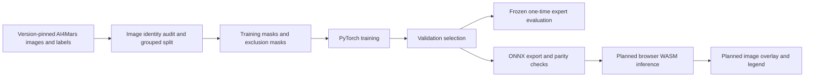

# Architecture (work in progress)

The audit, train/validation preparation, baseline and compact model experiments exist. A guarded expert evaluation and trained-baseline ONNX/Chrome tensor parity have been tested locally. The scratch model and protocol were frozen before a one-time expert evaluation. Upload preprocessing, application and public deployment remain unfinished. Local raw data, cached prepared images and intermediate checkpoints are ignored by Git; tracked manifests bind the source and splits to checksums.
