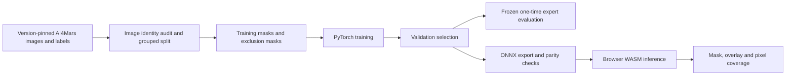

# Architecture

The data audit, train/validation preparation, scratch training and frozen expert evaluation are reproducible from the tracked manifests and experiment logs. The selected checkpoint is exported to a versioned ONNX file with metadata and integrity tests. Local raw data, prepared images and intermediate PyTorch checkpoints are ignored by Git.

The React/TypeScript client validates JPEG, PNG and WebP signatures, file size and dimensions; handles browser-corrected EXIF orientation; composites transparency onto black; letterboxes the image; and uses an explicit antialiased bilinear resize consistent with the training preprocessing for the tested rover image. It runs ONNX Runtime Web in single-threaded WASM, crops out padding, maps the mask back to the image aspect ratio and computes predicted pixel shares. Uploads do not leave the browser. A local Python ONNX API implements the same input contract.

The local production build has passed model-logit parity, a Python-reference image-to-mask check, desktop/mobile browser tests, an automated accessibility scan and asset-size checks. [Experiment results](experiments.md) describe the limitations of these checks. The repository is ready for Cloudflare Pages Git integration, but a public deployment has not yet been verified.
